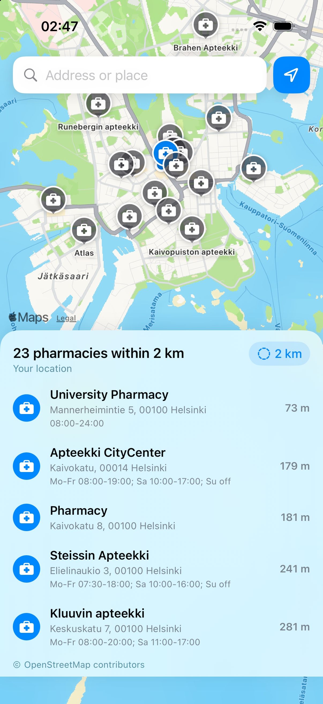

# Nearest Pharmacy — iOS

The pharmacy closest to you, in SwiftUI. Native iOS 17+, MapKit, CoreLocation and
OpenStreetMap. No third-party dependencies: the whole app is Swift and Apple
frameworks.

The sibling web app lives at
[nearest-pharmacy-web](https://github.com/senoldogann/nearest-pharmacy-web);
both answer the same question from the same data.



## Run it

```sh
brew install xcodegen          # once
xcodegen generate              # writes NearestPharmacy.xcodeproj
open NearestPharmacy.xcodeproj # ⌘R on any iPhone simulator
```

The Xcode project is generated from `project.yml`, so the repository stays free
of merge-hostile `project.pbxproj` churn. In Xcode, choose a simulator and run;
the app asks for location the first time, and also works from an address search
without any location permission.

## What it does

- **Your location or an address.** One tap for a GPS fix, or type a street and
  city; ambiguous addresses are offered as a short list to pick from.
- **Nearest first.** Pharmacies within 500 m – 10 km, measured with CoreLocation
  and sorted, so the first row is the answer.
- **A map that shows the answer.** MapKit map centred on the search, a pin per
  pharmacy, the nearest one highlighted in the accent colour.
- **What you need at the door.** Opening hours, phone (tap to call), website and
  a directions link, in a sheet with the distance and the search origin.
- **Finnish, Swedish and English** through `Localizable.strings`, with
  locale-aware distances (`73 m`, `2,4 km` in Finnish).
- **Accessible.** VoiceOver labels that say "University Pharmacy, 73 m away",
  combined rows, dynamic type, a readable status line for every loading and
  error state, and a 44 pt target for every control.

## Structure

```
Sources/
  App/           NearestPharmacyApp.swift      the entry point
  Models/        GeoPoint, Pharmacy, Place, PharmacyError
  Services/      PharmacyAPI, Overpass, Nominatim, LocationProvider
  ViewModels/    PharmacyStore                  state, search, map camera
  Views/         ContentView, SearchPanel, ResultsCard, PharmacyDetailView
Resources/       Info.plist (generated) and the three Localizable.strings
Tests/           GeoPointTests, MapDataTests, PharmacyAPITests
```

`PharmacyStore` is a single `@Observable` object on the main actor: views read
its state and call its async actions, and nothing else in the app mutates state.

## Decisions worth knowing

- **Two data sources, one shape.** Overpass answers "everything inside a
  radius" with full OSM tags, but its public instances are sometimes busy or
  unreachable. When both mirrors fail, `PharmacyAPI` asks Nominatim, which
  answers from the same OpenStreetMap data, and the result says which source
  answered. A failed request becomes a readable sentence, never an empty list
  pretending there are no pharmacies.
- **Distances are computed here.** Overpass `around:` is a bounding filter, so
  every pharmacy is re-measured with `CLLocation.distance(from:)` and filtered
  by the true radius before it is shown. The UI says straight-line, not walking.
- **The network is behind one door.** `PharmacyAPI` is a `Sendable` struct with
  an injectable `URLSession`; the services parse JSON into `ParsedPharmacy` and
  never touch views. That is why the tests can cover mirror fallback, outages
  and radius clamping without the network.
- **Nominatim is throttled.** Its usage policy allows one request a second, so
  an actor serialises those calls instead of trusting the call sites.
- **Privacy.** No accounts, no analytics, no server of our own. The only
  requests are OpenStreetMap queries with the coordinates of the search, and
  nothing is stored but the ten-minute in-memory cache in the web sibling.

## Tests

```sh
xcodebuild -project NearestPharmacy.xcodeproj -scheme NearestPharmacy \
  -destination 'platform=iOS Simulator,name=iPhone 17' test
```

16 tests, all green:

| File | Covers |
|---|---|
| `GeoPointTests` | distance against known Helsinki landmarks, validation, distance formatting |
| `MapDataTests` | Overpass query and tag parsing (including unnamed pharmacies and broken JSON), Nominatim viewbox and parsing, place search |
| `PharmacyAPITests` | nearest-first sorting, radius filtering and clamping, Overpass → Nominatim fallback, both-sources failure, and rejection of bad coordinates before any request |

`PharmacyAPITests` stubs `URLProtocol`, so the suite never touches the network.

## Data and licence

Pharmacy data © [OpenStreetMap](https://www.openstreetmap.org/copyright)
contributors (ODbL); maps by Apple. The code is MIT licensed — see
[LICENSE](LICENSE).
